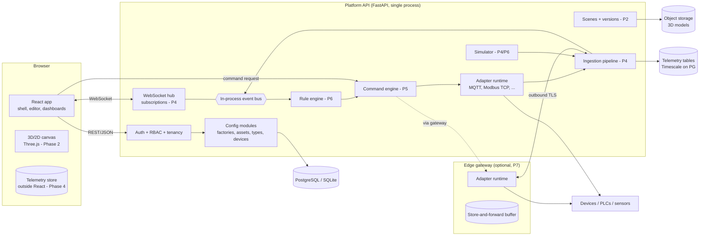
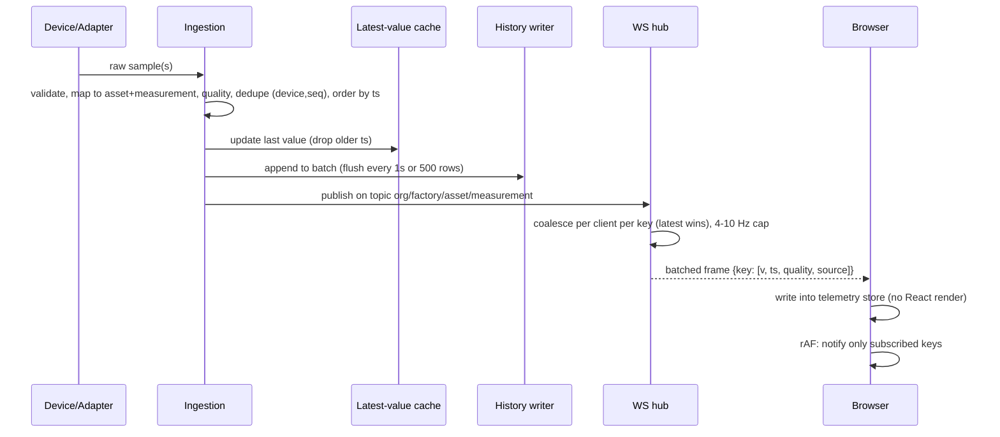

# Architecture

Universal Industrial Digital Twin Platform. This document is the technical design
the implementation follows. Sections marked **(built)** exist in the code today;
everything else is the target design for later phases (see
[IMPLEMENTATION_ROADMAP.md](IMPLEMENTATION_ROADMAP.md)).

## 1. Guiding decisions

| Decision | Choice | Why |
|---|---|---|
| Backend language | Python 3.12, FastAPI, Pydantic v2, SQLAlchemy 2 | Industrial protocol libraries (pymodbus, asyncua, paho/aiomqtt, python-snap7, BAC0) are strongest in Python. FastAPI gives typed REST + WebSockets in one process. |
| Frontend | React 18 + TypeScript + Vite, plain CSS variables | Lightweight: no UI kit, no CSS framework. Three.js / React Three Fiber added in Phase 2 only for the canvas. |
| Primary DB | SQLite (dev / single-site edge) → PostgreSQL (production) | Same SQLAlchemy models; `DATABASE_URL` switches. No infrastructure needed to start. |
| Time-series | Phase 4: TimescaleDB hypertable on PostgreSQL; SQLite table with downsampling on edge | Avoids a second database product. |
| Messaging | In-process async event bus first; MQTT broker (Mosquitto) only for devices that speak MQTT; NATS only if multi-node fan-out is required | No Kafka. Do not add infrastructure until measured load needs it. |
| Process model | **Modular monolith** (one API process) + optional **edge gateway** process | No microservices. Modules have hard boundaries (packages) so they can be split later if needed. |
| Flexible metadata | Typed core columns + JSON columns validated against an `AssetType` schema | New sensor/machine kinds are data, not code. No schema migration per device type. |

## 2. System architecture



Key boundary rules:

* The **browser never talks to devices**. All industrial I/O goes through backend
  adapters or an edge gateway. Credentials never leave the backend.
* **Ingestion and rendering are separate pipelines.** Telemetry lands in a
  non-React store; components subscribe to individual keys.
* **Simulation goes through the same ingestion path** but every record is tagged
  `source=simulated`; simulated sessions can only target the simulated adapter.

## 3. Domain model (summary)

Full detail in [DATABASE_SCHEMA.md](DATABASE_SCHEMA.md).

```
Organization 1─* User
Organization 1─* Factory 1─* FactoryFloor 1─* ProductionArea
Organization 1─* AssetType           (defines properties, telemetry, controls, visual)
Factory      1─* Asset ─* AssetType  (asset identity; parent_id gives hierarchy)
Asset        1─* Device              (a device is a data source bound to an asset)
Asset        1─* SceneObject - P2    (visual representation; many per asset)
Device       1─* TelemetryRecord - P4
Asset        1─* ControlCommand - P5 ─* CommandExecution
Organization 1─* AuditLog
```

**Asset identity is separate from visuals.** An `Asset` has no geometry. A
`SceneObject` (Phase 2) references an asset and carries transform, model and
2D/3D representation, so 2D and 3D views and dashboards are projections of the
same asset — switching modes can never duplicate an asset.

### Metadata-driven asset types (built)

An `AssetType` holds four validated definition lists:

* `property_schema` — custom attributes: `{key, label, type: number|integer|string|boolean|enum, unit, required, min, max, options, default}`
* `telemetry` — measurements: `{key, label, data_type, unit, min, max, warn_low, warn_high, alarm_low, alarm_high}`
* `controls` — commands/setpoints: `{key, label, kind: command|setpoint, unit, min, max, requires_confirmation, min_role}`
* `visual` — default representation: `{shape, color, model_url, size}`

Asset `properties` are validated against the type's `property_schema` on every
write (unknown keys rejected, ranges/enums enforced, defaults applied). Asset
types are seeded **as data** per organization; nothing in code switches on a type
key.

## 4. Backend module structure (built for Phase 1)

```
backend/app/
  core/       config, db session, security (JWT/bcrypt), credential encryption,
              permissions (role → permission matrix), request deps
  models/     SQLAlchemy models, one module per bounded context
  schemas/    Pydantic request/response models + definition validators
  services/   domain logic (property validation, audit)
  api/        routers: auth, factories, asset_types, assets, devices, audit, health
  adapters/   DeviceAdapter interface, registry, simulated adapter
  seed/       demo factory loader
```

Tenancy: every tenant-owned row carries `org_id`. Routers obtain the caller via
`current_user` and every query is filtered by `org_id`; lookups by id go through
`get_owned()` which returns 404 for another tenant's id (no existence leak).
Tested in `tests/test_tenancy.py`.

## 5. Frontend architecture

```
frontend/src/
  api/          fetch client (token, ApiError with field errors), shared types
  auth/         AuthContext (me, permissions), LoginPage (sign in / register)
  layout/       AppShell (left nav, top bar: factory selector, mode, theme), FactoryContext
  pages/        Overview, Factory layout, Assets, Asset types, Devices (+ wizard), Audit
  components/   ui.tsx (Modal, Field, Pill, Tabs, Confirm...), DynamicForm (renders a
                property_schema), DefTable (edits definition lists without JSON), Icon, Toast
  lib/          useApi (minimal server-state hook), formatting + unit conversion
  styles/       app.css (design tokens, dark/light themes)
```

Phase 2 adds `editor/` (scene store with command-pattern undo/redo, R3F canvas,
gizmos, asset library, properties panel). Phase 4 adds `live/` (WebSocket client
with reconnect/backoff, telemetry store keyed by `assetId:measurement`, a
`useTelemetry(key)` hook built on `useSyncExternalStore`, rAF-throttled flush).

## 6. Device integration architecture

See [DEVICE_INTEGRATION.md](DEVICE_INTEGRATION.md). Summary:

* `DeviceAdapter` abstract class: `connect, disconnect, test_connection,
  discover_capabilities, read_telemetry, write_command, get_device_status,
  get_diagnostics`, plus a declarative `config_schema` the UI renders as a form.
* Adapters register in `adapters.registry` by protocol key; third-party adapters
  are discovered via Python entry points (`twin.adapters`) — Phase 3.
* Phase 1 ships the interface and a **simulated** adapter only. MQTT and Modbus
  TCP are Phase 3. Protocols needing hardware or licensed stacks (S7, EtherNet/IP,
  BACnet, serial/RS485, CAN) are only listed as planned; the UI does not offer them.

## 7. Real-time event architecture (Phase 4 design)



* Subscriptions are explicit (`subscribe {factory, assets?, measurements?}`),
  authorized against the caller's org on subscribe.
* Backpressure: per-client bounded queue; on overflow keep latest value per key
  (never drop the *history* write — history is persisted independently).
* Staleness: each telemetry definition gets an expected interval; values older
  than 3× are shown as **stale**; devices without heartbeat are **offline**.
  The UI never animates a machine as running from stale data.
* Data quality enum on every value: `good | uncertain | bad | stale`, plus
  `source: live | simulated | playback`.

## 8. Control architecture (Phase 5 design)

Lifecycle: `REQUESTED → VALIDATING → APPROVED → SENT → ACKNOWLEDGED → COMPLETED`,
terminal failures `REJECTED | FAILED | TIMED_OUT | CANCELLED`.

Validation chain (all must pass, every step audited): role permission → per-asset
grant → capability exists on the asset type → parameter range → interlocks
(declared conditions on live telemetry; stale data ⇒ fail closed) → rate limit →
explicit confirmation token for `requires_confirmation` → optional second-person
approval. `COMPLETED` requires device acknowledgement **and**, where a feedback
measurement is declared, the expected state observed in telemetry within a
timeout. Otherwise the command ends `TIMED_OUT` and the UI shows "state
unverified".

**Safety position:** the platform is a supervisory (Level 3-ish) tool. It never
replaces PLC logic, safety relays or hardwired E-stops. There is no software
E-stop button; E-stop *status* may be displayed when a device reports it.
Simulation sessions can only dispatch to the simulated adapter (enforced in the
command engine, not the UI).

## 9. Rendering architecture (Phase 2 design)

* Three.js via React Three Fiber, `frameloop="demand"` — render only on camera
  move, edit, or telemetry-driven visual change.
* Scene store (Zustand) holds scene objects by id; each object component selects
  only its own slice, so one edit re-renders one object.
* Repeated primitives (sensors, conveyor segments, pillars) use `InstancedMesh`
  grouped by (geometry, material). GLB models: Draco/meshopt compression,
  `useGLTF` cache, LOD via `<Detailed>`, lazy loading by area.
* Telemetry → visuals: per-frame `useFrame` reads from the telemetry store
  directly (refs, not state) to drive rotation/colour; no React reconciliation.
* 2D mode = orthographic top-down camera on the same scene + simplified symbol
  layer; same `SceneObject` records.
* Built-in perf HUD: FPS, frame ms, draw calls, triangles, objects, WS latency.

## 10. Security architecture

Built in Phase 1: bcrypt password hashing, JWT (HS256, 8h expiry), role →
permission matrix, tenant scoping on every query, device credentials encrypted at
rest (Fernet, key from env) and **write-only** through the API, audit log for every
configuration mutation, Pydantic validation on all input, CORS allow-list,
production start refuses default secrets.

Later: WebSocket auth via short-lived ticket, login rate limiting, refresh tokens /
session revocation, per-asset ACLs, mTLS for edge gateways, secret store
integration (Vault / cloud KMS), backup/restore tooling.

## 11. Highest-risk engineering decisions

| Risk | Why it is hard | Mitigation |
|---|---|---|
| 3D performance at thousands of objects | Draw calls and React reconciliation, not triangles, are usually the bottleneck | Instancing, demand rendering, per-object store selectors, telemetry via refs, perf HUD + synthetic 5k-object benchmark scene in Phase 2 |
| Scene editability (undo/redo, versioning, collaboration) | Easy to corrupt state with ad-hoc mutations | All edits are commands (do/undo) on a normalized store; saves are immutable `SceneVersion` snapshots; optimistic version check on save (409 on conflict) |
| Protocol integration | Protocols differ fundamentally (poll vs push, addressing, types, byte order) | Adapter interface is narrow; per-protocol `config_schema` and point-address model; never pretend protocols are interchangeable; simulator for every adapter test |
| Telemetry scalability | Python per-message overhead; fan-out to many clients | Batch everywhere; latest-value coalescing; history writes in bulk; measure with load test before adding NATS or a second process |
| Bidirectional control | Real equipment, real injury risk | Fail-closed validation chain, ack + telemetry verification, no software E-stop, simulated-only commands until a controlled test rig exists |
| Security / tenancy | One leak = cross-customer data exposure | Org scoping in a single helper, tenancy tests for every resource, credentials write-only |
| Edge gateway sync | Intermittent links, duplicates, clock skew | Gateway-assigned monotonic sequence per device, idempotent ingest keyed (device, seq), store-and-forward with bounded disk buffer, gateway-side timestamps |
