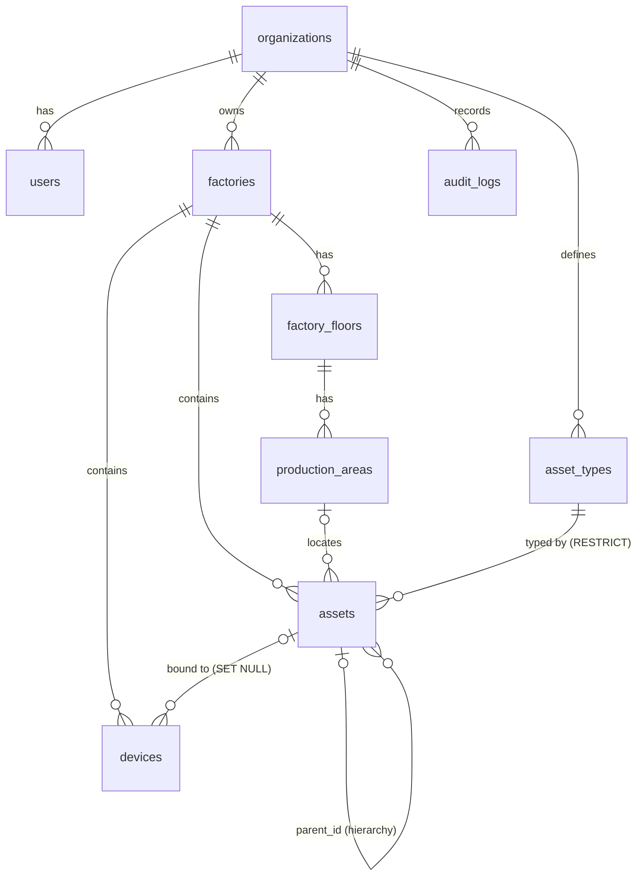

# Database schema

SQLAlchemy models live in `backend/app/models/`. All ids are UUID strings. All
timestamps are timezone-aware UTC (`UTCDateTime`). Every tenant-owned table has
`org_id` (FK → organizations, cascade delete), and every query filters on it.

Tables are created with `create_all` in Phase 1. **Alembic migrations are needed
before the first production deployment**: until then, schema changes require
recreating the dev database (`rm backend/data/twin.db`).

## Entity relationships (Phase 1, built)

## Tables

### organizations
`id, name, slug (unique), created_at, updated_at`

### users
`id, org_id, email (unique, case-insensitive lookup), name, password_hash (bcrypt), role (admin|engineer|operator|viewer), is_active`

### factories
`id, org_id, name, description, location, timezone, length_unit (mm|cm|m|ft; display only, lengths are stored in metres)`

### factory_floors
`id, org_id, factory_id, name, level, elevation_m, width_m, depth_m`

### production_areas
`id, org_id, floor_id, name, kind (production|storage|walkway|safety|utility|office), bounds JSON {x, z, width, depth} in metres`

### asset_types
`id, org_id, key (unique per org), name, category, description, icon, property_schema JSON[], telemetry JSON[], controls JSON[], visual JSON, version`

Each list item is validated by Pydantic (`app/schemas/definitions.py`):

| Definition | Fields |
|---|---|
| `PropertyDef` | `key, label, type (number/integer/string/boolean/enum), unit, required, min, max, options, default, group, help` |
| `TelemetryDef` | `key, label, data_type, unit, min, max, warn_low, warn_high, alarm_low, alarm_high, options, expected_interval_s` |
| `ControlDef` | `key, label, kind (command/setpoint), params[], requires_confirmation, min_role, feedback_measurement, description` |
| `VisualDef` | `shape, color (#rrggbb), model_url, size [w,h,d] m` |

Changing `property_schema` re-validates every asset of that type in the same
transaction. Values of removed properties are dropped, defaults are applied, and
any asset that would become invalid blocks the change (409).

### assets
`id, org_id, factory_id, area_id?, parent_id?, asset_type_id, code (unique per org, e.g. MTR-101), name, description, manufacturer, model, serial_number, tags JSON[], properties JSON (validated against type), operating_limits JSON, lifecycle_status (active|maintenance|decommissioned), version`

Assets carry **no geometry**. Visual representations (scene objects, Phase 2)
reference `asset.id`, which keeps the physical identity separate from any 2D, 3D or
dashboard view. `version` increments on every change and supports optimistic
concurrency (`PATCH` with a stale `version` returns 409).

### devices
`id, org_id, factory_id, asset_id?, name, protocol, connection_config JSON (non-secret, validated by adapter), credentials_encrypted (Fernet; never returned), point_mappings JSON [{point, measurement, scale, offset}], gateway_id?, enabled, last_test_status (unknown|ok|error), last_test_message, last_test_at`

### audit_logs
`id, org_id, at, user_id?, user_email, action (e.g. asset.update), entity_type, entity_id, summary, details JSON (field diffs; never secrets)`

## Planned tables (later phases)

| Phase | Tables |
|---|---|
| 2 | `scenes`, `scene_objects` (asset_id?, transform, model ref, layer, locked, hidden), `scene_versions` (immutable snapshots), `model_files` |
| 4 | `telemetry_records` (hypertable on PostgreSQL+Timescale: ts, org_id, asset_id, measurement, value_num, value_text, quality, source, device_id, seq; PK (asset_id, measurement, ts)), `latest_values` (in Redis or memory) |
| 5 | `control_commands`, `command_executions` (state machine + timestamps per transition), `interlocks` |
| 6 | `alerts`, `alert_rules`, `automation_rules`, `automation_executions`, `dashboards`, `dashboard_widgets`, `simulation_sessions` |
| 7 | `roles`, `permissions`, `asset_grants`, `gateways`, `gateway_sync_state`, `api_keys` |
