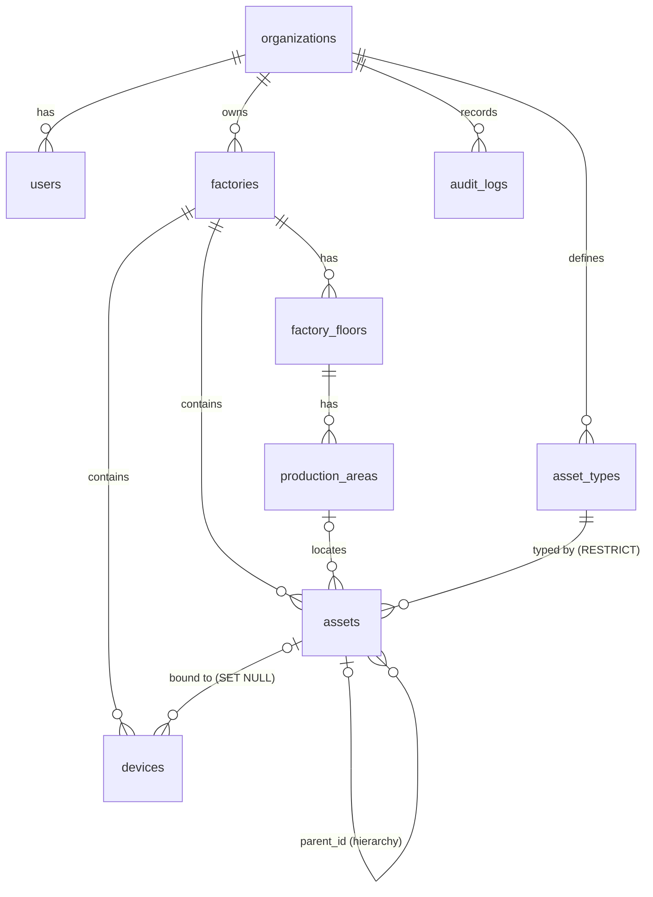

# Database schema

SQLAlchemy models live in `backend/app/models/`. All ids are UUID strings. All
timestamps are timezone-aware UTC (`UTCDateTime`). Every tenant-owned table has
`org_id` (FK → organizations, cascade delete), and every query filters on it.

Tables are created with `create_all` in Phase 1. **Alembic migrations are needed
before the first production deployment**: until then, schema changes require
recreating the dev database (`rm backend/data/twin.db`).

## Entity relationships (Phase 1, built)

## Tables

### organizations
`id, name, slug (unique), created_at, updated_at`

### users
`id, org_id, email (unique, case-insensitive lookup), name, password_hash (bcrypt), role (admin|engineer|operator|viewer), is_active`

### factories
`id, org_id, name, description, location, timezone, length_unit (mm|cm|m|ft; display only, lengths are stored in metres)`

### factory_floors
`id, org_id, factory_id, name, level, elevation_m, width_m, depth_m`

### production_areas
`id, org_id, floor_id, name, kind (production|storage|walkway|safety|utility|office), bounds JSON {x, z, width, depth} in metres`

### asset_types
`id, org_id, key (unique per org), name, category, description, icon, property_schema JSON[], telemetry JSON[], controls JSON[], visual JSON, version`

Each list item is validated by Pydantic (`app/schemas/definitions.py`):

| Definition | Fields |
|---|---|
| `PropertyDef` | `key, label, type (number/integer/string/boolean/enum), unit, required, min, max, options, default, group, help` |
| `TelemetryDef` | `key, label, data_type, unit, min, max, warn_low, warn_high, alarm_low, alarm_high, options, expected_interval_s` |
| `ControlDef` | `key, label, kind (command/setpoint), params[], requires_confirmation, min_role, feedback_measurement, description` |
| `VisualDef` | `shape, color (#rrggbb), model_url, size [w,h,d] m` |

Changing `property_schema` re-validates every asset of that type in the same
transaction. Values of removed properties are dropped, defaults are applied, and
any asset that would become invalid blocks the change (409).

### assets
`id, org_id, factory_id, area_id?, parent_id?, asset_type_id, code (unique per org, e.g. MTR-101), name, description, manufacturer, model, serial_number, tags JSON[], properties JSON (validated against type), operating_limits JSON, lifecycle_status (active|maintenance|decommissioned), version`

Assets carry **no geometry**. Visual representations (scene objects, Phase 2)
reference `asset.id`, which keeps the physical identity separate from any 2D, 3D or
dashboard view. `version` increments on every change and supports optimistic
concurrency (`PATCH` with a stale `version` returns 409).

### devices
`id, org_id, factory_id, asset_id?, name, protocol, connection_config JSON (non-secret, validated by adapter), credentials_encrypted (Fernet; never returned), point_mappings JSON [{point, measurement, scale, offset}], gateway_id?, enabled, last_test_status (unknown|ok|error), last_test_message, last_test_at`

### audit_logs
`id, org_id, at, user_id?, user_email, action (e.g. asset.update), entity_type, entity_id, summary, details JSON (field diffs; never secrets)`

### scenes (Phase 2)
`id, org_id, factory_id (unique), name, version, updated_by`

### scene_objects (Phase 2)
`id (client UUID), org_id, scene_id, asset_id? (FK assets, CASCADE), kind, name, shape, position/rotation/scale/size JSON[3], color, opacity, model_id?, floor_id?, group_id?, locked, hidden, sort, props JSON`. Saving replaces the scene's objects atomically.

### scene_versions (Phase 2)
`id, org_id, scene_id, version, message, created_by, created_at, object_count, snapshot JSON` (immutable full copy of the objects).

### model_files (Phase 2)
`id, org_id, filename, format (glb|obj|stl), size_bytes, storage_path, uploaded_by`. File bytes are stored under `MODEL_STORAGE_DIR/<org_id>/`.

### telemetry_records (Phase 4)
`id, org_id, asset_id, measurement, ts, value_num?, value_text?, quality, source (live|simulated), device_id`. Index `(asset_id, measurement, ts)`. Pruned after `TELEMETRY_RETENTION_HOURS`. On PostgreSQL convert to a Timescale hypertable.

### dashboards (Phase 6 part)
`id, org_id, factory_id, name, widgets JSON, created_by`.

### device_templates (Phase 3)
`id, org_id, key, name, protocol, description, asset_type_key, connection_config JSON, point_mappings JSON, control_mappings JSON, builtin`

### devices: added columns (Phase 3/5)
`control_mappings JSON [{control, point, value, param, scale}]`, `template_id`

### interlocks (Phase 5)
`id, org_id, asset_id, control_key ('*' = all), source_asset_id, measurement, operator, value, message, enabled`

### control_commands (Phase 5)
`id, org_id, factory_id, asset_id, device_id, control_key, control_label, params JSON, status, simulated, verified, reason, requested_by, requested_at, approved_by, approved_at, sent_at, acked_at, finished_at, result_message, checks JSON, events JSON`

### alerts (Phase 6 part)
`id, org_id, factory_id, asset_id, device_id, kind (limit|state|comm|command), measurement, severity (warning|alarm), active, message, value_num, value_text, threshold, source, raised_at, updated_at, cleared_at, acked, acked_by, acked_at`

### users: added columns
`must_change_password`, `last_login_at`

New columns are added to existing databases automatically at start-up (`app/core/schema_sync.py`).

### telemetry_hourly (Phase 6)
`org_id, asset_id, measurement, hour, count, avg, min, max, first_num, last_num, last_text, states JSON {state: seconds, _starts}, source`. Unique `(asset_id, measurement, hour)`, kept 400 days.

### notification_channels / notification_deliveries (Phase 6)
Channels: `name, type (webhook|email), config JSON, secrets_encrypted, enabled, alerts, min_severity, notify_clear`. Deliveries: `channel_id, at, event, subject, status, attempts, detail`.

### automation_rules / automation_executions (Phase 6)
Rules: `factory_id, name, description, enabled, trigger JSON, conditions JSON, actions JSON, cooldown_s, run_as_user_id, created_by, version, last_fired_at`. Executions: `rule_id, started_at, finished_at, status (succeeded|partial|failed|skipped|dry_run), dry_run, trigger_detail, steps JSON`.

### simulation_scenarios (Phase 6)
`factory_id, name, description, steps JSON, created_by`.

## Planned tables (later phases)

| Phase | Tables |
|---|---|
| 4 | `latest_values` persisted (Redis or a table) for restart continuity |
| 7 | `roles`, `permissions`, `asset_grants`, `gateways`, `gateway_sync_state`, `api_keys` |
